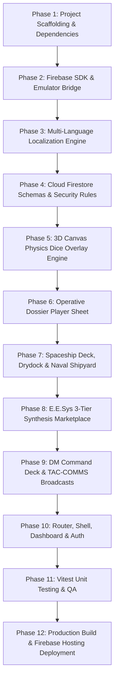

# 📋 UNENDING VOID — Autonomous AI Agent Implementation Plan & Replication Blueprint

> **Notice for AI Agents (Antigravity, Claude, Cursor, Copilot Workspace, etc.):**
> This document is a complete, turnkey, parametric blueprint. When provided to an AI agent in an empty directory or existing workspace, following the steps in this blueprint from Phase 1 through Phase 12 will produce a fully functional, localized, tested, and deployed **Unending Void Virtual Tabletop (VTT)** web application.

---

## ⚙️ 1. Parametric Configuration Block

Before handing this document to an AI agent, customize the parameter variables below. Any occurrence of `{{VARIABLE_NAME}}` throughout this plan should be substituted with the specified values.

```yaml
# ==============================================================================
# PARAMETRIC VARIABLES CONFIGURATION
# ==============================================================================
PROJECT_NAME: "{{PROJECT_NAME}}"                       # Default: "unendingvoid"
APP_DISPLAY_NAME: "{{APP_DISPLAY_NAME}}"               # Default: "Unending Void"
DIST_FOLDER_PATH: "{{DIST_FOLDER_PATH}}"               # Default: "dist"
GIT_REPOSITORY_URL: "{{GIT_REPOSITORY_URL}}"           # e.g.: "https://github.com/JudasTheUG/unendingvoid.git"

# Firebase Cloud Configuration
FIREBASE_PROJECT_ID: "{{FIREBASE_PROJECT_ID}}"         # e.g.: "unendingvoid-app"
FIREBASE_API_KEY: "{{FIREBASE_API_KEY}}"               # Web API Key from Firebase Console
FIREBASE_AUTH_DOMAIN: "{{FIREBASE_AUTH_DOMAIN}}"       # e.g.: "{{FIREBASE_PROJECT_ID}}.firebaseapp.com"
FIREBASE_STORAGE_BUCKET: "{{FIREBASE_STORAGE_BUCKET}}" # e.g.: "{{FIREBASE_PROJECT_ID}}.firebasestorage.app"
FIREBASE_MESSAGING_SENDER_ID: "{{FIREBASE_MESSAGING_SENDER_ID}}" # e.g.: "1234567890"
FIREBASE_APP_ID: "{{FIREBASE_APP_ID}}"                 # e.g.: "1:1234567890:web:abcdef123456"
FIREBASE_MEASUREMENT_ID: "{{FIREBASE_MEASUREMENT_ID}}" # e.g.: "G-XXXXXXXXXX"
FIREBASE_HOSTING_URL: "{{FIREBASE_HOSTING_URL}}"       # e.g.: "https://{{FIREBASE_PROJECT_ID}}.web.app"

# Local Development & Emulator Ports
DEV_SERVER_PORT: "{{DEV_SERVER_PORT}}"                 # Default: "5173"
FIREBASE_AUTH_EMULATOR_PORT: "{{FIREBASE_AUTH_EMULATOR_PORT}}"         # Default: "9099"
FIREBASE_FIRESTORE_EMULATOR_PORT: "{{FIREBASE_FIRESTORE_EMULATOR_PORT}}" # Default: "8080"
FIREBASE_HOSTING_EMULATOR_PORT: "{{FIREBASE_HOSTING_EMULATOR_PORT}}"   # Default: "5000"
FIREBASE_UI_EMULATOR_PORT: "{{FIREBASE_UI_EMULATOR_PORT}}"             # Default: "4000"

# Localization Mandate
SUPPORTED_LOCALES: ["en", "tr", "de"]                  # English (en), Turkish (tr), German (de)
DEFAULT_LOCALE: "en"                                   # Fallback locale

# Cyberpunk / Sci-Fi Theme Color Palette
THEME_BG: "#050814"                                    # Deep Obsidian Void
THEME_CYAN: "#00F0FF"                                  # Cyber Neon Cyan
THEME_PURPLE: "#A855F7"                                # Tachyon Neon Violet
THEME_AMBER: "#F59E0B"                                 # Warning Amber
THEME_GREEN: "#10B981"                                 # Shield Matrix Green
THEME_RED: "#EF4444"                                   # Critical Hull Red
```

---

## 🛠️ 2. User Pre-Flight Prerequisites Checklist

> [!IMPORTANT]
> **Human Developer Action Required Prior to AI Agent Invocation:**
> The following prerequisites MUST be created or configured by the human developer before asking the AI agent to begin execution:

- [ ] **Prerequisite 1: Node.js LTS (v20 or higher) & Git**
  - Install Node.js v20+ from [nodejs.org](https://nodejs.org).
  - Verify terminal availability: `node -v` and `git --version`.
- [ ] **Prerequisite 2: Firebase Console Project**
  - Navigate to [Firebase Console](https://console.firebase.google.com).
  - Create a new project with Project ID: `{{FIREBASE_PROJECT_ID}}`.
- [ ] **Prerequisite 3: Enable Firebase Authentication**
  - In Firebase Console under **Build > Authentication > Sign-in method**:
    - Enable **Email/Password**.
    - Enable **Anonymous** (critical for seamless guest player onboarding and automated testing).
- [ ] **Prerequisite 4: Create Cloud Firestore Database**
  - In Firebase Console under **Build > Firestore Database**:
    - Create a database in your preferred geographic location.
    - Start in **Test Mode** (or Production Mode; security rules will be deployed in Phase 4).
- [ ] **Prerequisite 5: Firebase CLI Installation & Authentication**
  - Install Firebase CLI globally: `npm install -g firebase-tools`
  - Login on your machine: `firebase login`
  - Verify project link: `firebase projects:list` (must list `{{FIREBASE_PROJECT_ID}}`).
- [ ] **Prerequisite 6: Local Workspace & Environment Configuration**
  - Create project directory `{{PROJECT_NAME}}`.
  - Populate `.env.local` with the Firebase credentials obtained from *Project Settings > Web Apps*:
    ```ini
    VITE_FIREBASE_API_KEY={{FIREBASE_API_KEY}}
    VITE_FIREBASE_AUTH_DOMAIN={{FIREBASE_AUTH_DOMAIN}}
    VITE_FIREBASE_PROJECT_ID={{FIREBASE_PROJECT_ID}}
    VITE_FIREBASE_STORAGE_BUCKET={{FIREBASE_STORAGE_BUCKET}}
    VITE_FIREBASE_MESSAGING_SENDER_ID={{FIREBASE_MESSAGING_SENDER_ID}}
    VITE_FIREBASE_APP_ID={{FIREBASE_APP_ID}}
    VITE_FIREBASE_MEASUREMENT_ID={{FIREBASE_MEASUREMENT_ID}}
    ```

---

## 🤖 3. AI Agent System Directives & Architectural Constraints

When building the application, the AI Agent must strictly adhere to these rules:

1. **🌐 Continuous Tri-Lingual Localization Mandate**:
   - Every single screen, component, modal, toast, button, HUD metric, item description, and notification MUST use `useTranslation()` (`t('key')`).
   - ZERO hardcoded English, Turkish, or German strings in JSX.
   - Every added key must be simultaneously added across `src/locales/en/common.json`, `src/locales/tr/common.json`, and `src/locales/de/common.json`.
   - The UI must dynamically switch language instantly without page reloads.
2. **🎨 Cyberpunk / Sci-Fi High-Contrast Aesthetic**:
   - Dark background palette (`bg-[#050814]`), glassmorphism panels (`backdrop-blur-md bg-black/40 border border-cyan-500/30`), neon accent glows (`shadow-[0_0_15px_rgba(0,240,255,0.3)]`).
   - Monospace typography for coordinates, credits, dice formulas, and vital telemetry.
3. **🧪 Unit Testing Mandate**:
   - Every mathematical rule (initiative, ship reactor grid balance, mass-to-thrust ratio, dice modifiers) and state action (healing, damage, rest, campaign removal, character deletion) must be validated with Vitest unit tests.
   - Build target: `{{DIST_FOLDER_PATH}}`.

---

## 🚀 4. Step-by-Step AI Execution Blueprint



---

### Phase 1: Project Scaffolding & Dependencies

> **Goal**: Initialize a React 19 + Vite 6 + Tailwind CSS v4 workspace configured to build to `{{DIST_FOLDER_PATH}}`.

#### 1.1 Initialize Vite React Project
```powershell
# From workspace root
npx -y create-vite@latest ./ --template react
npm install
```

#### 1.2 Install Core Runtime & Developer Dependencies
```powershell
# Core Dependencies
npm install firebase react-router-dom i18next react-i18next i18next-browser-languagedetector lucide-react canvas-confetti three

# Dev & Testing Dependencies
npm install -D tailwindcss @tailwindcss/vite vitest jsdom @testing-library/react @testing-library/jest-dom jest-axe oxlint
```

#### 1.3 Configure Vite (`vite.config.js`)
Ensure Vite outputs to `{{DIST_FOLDER_PATH}}`:
```javascript
import { defineConfig } from 'vite';
import react from '@vitejs/plugin-react';
import tailwindcss from '@tailwindcss/vite';

export default defineConfig({
  plugins: [react(), tailwindcss()],
  build: {
    outDir: '{{DIST_FOLDER_PATH}}',
    emptyOutDir: true,
  },
  server: {
    port: {{DEV_SERVER_PORT}},
  },
  test: {
    globals: true,
    environment: 'jsdom',
    setupFiles: ['./src/test/setup.js'],
  },
});
```

#### 1.4 Configure Tailwind CSS & Design Tokens (`src/index.css`)
```css
@import "tailwindcss";

@layer base {
  body {
    background-color: {{THEME_BG}};
    color: #e2e8f0;
    font-family: 'Inter', system-ui, -apple-system, sans-serif;
    overflow-x: hidden;
  }
}

/* Custom Cyberpunk HUD Utilities */
.neon-border-cyan {
  border: 1px solid rgba(0, 240, 255, 0.4);
  box-shadow: 0 0 15px rgba(0, 240, 255, 0.2), inset 0 0 10px rgba(0, 240, 255, 0.1);
}

.neon-border-purple {
  border: 1px solid rgba(168, 85, 247, 0.4);
  box-shadow: 0 0 15px rgba(168, 85, 247, 0.2);
}

.glass-panel {
  background: rgba(5, 8, 20, 0.85);
  backdrop-filter: blur(12px);
  border: 1px solid rgba(0, 240, 255, 0.2);
}
```

---

### Phase 2: Firebase SDK & Local Emulator Infrastructure

> **Goal**: Connect React with Cloud Firestore and Auth, support offline development with local emulators, and output to `{{DIST_FOLDER_PATH}}`.

#### 2.1 Configure `src/lib/firebase.js`
```javascript
import { initializeApp } from 'firebase/app';
import { getAuth, connectAuthEmulator } from 'firebase/auth';
import { getFirestore, connectFirestoreEmulator } from 'firebase/firestore';

const firebaseConfig = {
  apiKey: import.meta.env.VITE_FIREBASE_API_KEY,
  authDomain: import.meta.env.VITE_FIREBASE_AUTH_DOMAIN,
  projectId: import.meta.env.VITE_FIREBASE_PROJECT_ID || '{{FIREBASE_PROJECT_ID}}',
  storageBucket: import.meta.env.VITE_FIREBASE_STORAGE_BUCKET,
  messagingSenderId: import.meta.env.VITE_FIREBASE_MESSAGING_SENDER_ID,
  appId: import.meta.env.VITE_FIREBASE_APP_ID,
  measurementId: import.meta.env.VITE_FIREBASE_MEASUREMENT_ID,
};

const app = initializeApp(firebaseConfig);
export const auth = getAuth(app);
export const db = getFirestore(app);

// Connect to local emulators during development if configured
if (import.meta.env.DEV) {
  try {
    connectAuthEmulator(auth, 'http://127.0.0.1:{{FIREBASE_AUTH_EMULATOR_PORT}}', { disableWarnings: true });
    connectFirestoreEmulator(db, '127.0.0.1', {{FIREBASE_FIRESTORE_EMULATOR_PORT}});
    console.log('[Firebase] Connected to local emulators');
  } catch (e) {
    console.warn('[Firebase] Emulator connection skipped or already initialized');
  }
}
```

#### 2.2 Configure `firebase.json` & `.firebaserc`
`firebase.json`:
```json
{
  "firestore": {
    "rules": "firestore.rules"
  },
  "hosting": {
    "public": "{{DIST_FOLDER_PATH}}",
    "ignore": ["firebase.json", "**/.*", "**/node_modules/**"],
    "rewrites": [{ "source": "**", "destination": "/index.html" }]
  },
  "emulators": {
    "auth": { "port": {{FIREBASE_AUTH_EMULATOR_PORT}} },
    "firestore": { "port": {{FIREBASE_FIRESTORE_EMULATOR_PORT}} },
    "hosting": { "port": {{FIREBASE_HOSTING_EMULATOR_PORT}} },
    "ui": { "enabled": true, "port": {{FIREBASE_UI_EMULATOR_PORT}} }
  }
}
```

`.firebaserc`:
```json
{
  "projects": {
    "default": "{{FIREBASE_PROJECT_ID}}"
  }
}
```

---

### Phase 3: Multi-Language Localization Engine (i18n)

> **Goal**: Full internationalization supporting `en`, `tr`, and `de` with synchronized keys.

#### 3.1 Initialize i18next (`src/lib/i18n.js`)
```javascript
import i18n from 'i18next';
import { initReactI18next } from 'react-i18next';
import LanguageDetector from 'i18next-browser-languagedetector';

import en from '../locales/en/common.json';
import tr from '../locales/tr/common.json';
import de from '../locales/de/common.json';

i18n
  .use(LanguageDetector)
  .use(initReactI18next)
  .init({
    resources: {
      en: { translation: en },
      tr: { translation: tr },
      de: { translation: de },
    },
    fallbackLng: '{{DEFAULT_LOCALE}}',
    interpolation: { escapeValue: false },
  });

export default i18n;
```

#### 3.2 Implement Synchronized Translation Catalogs
Create three catalogs under `src/locales/`:
- `src/locales/en/common.json`
- `src/locales/tr/common.json`
- `src/locales/de/common.json`

Ensure all keys for operative vitals, spaceship builder, shipyard, E.E.Sys marketplace, dice HUD, and DM panel are 100% synchronized.

#### 3.3 Create Floating Language Switcher (`src/components/shared/LanguageSwitcher.jsx`)
Provide an accessible toggle that immediately updates language with `i18n.changeLanguage(lang)` without triggering page reloads.

---

### Phase 4: Cloud Firestore Schemas & Security Rules

> **Goal**: Establish real-time data schemas and deploy hardened Firestore security rules.

#### 4.1 Schema Definitions

1. **`players/{characterId}`**:
   - `id`: Character document ID.
   - `userId`: Firebase Auth UID of the owner.
   - `name`: Operative codename.
   - `class`: Cyber-class / specialization (e.g. Netrunner, Tech-Priest, Enforcer).
   - `level`: Operative level (1–20).
   - `vitals`: `{ hp, maxHp, shields, maxShields, stress, maxStress, tempHp, hitDiceCurrent, hitDiceMax }`.
   - `stats`: `{ str, dex, con, int, wis, cha }`.
   - `inventory`: Array of inventory items `{ id, name, type, weight, quantity, rarity, value }`.
   - `traits`: Array of trait IDs and cyberware augments.
   - `ship`: Starship object or `null`.
   - `credits`: Number (liquid currency balance).
   - `campaignId`: Reference to active campaign or `null`.

2. **`campaigns/{campaignId}`**:
   - `id`: Campaign document ID.
   - `title`: Name of the campaign.
   - `dmId`: Firebase Auth UID of the Game Master.
   - `inviteCode`: 6-character alphanumeric code.
   - `members`: Array of player UIDs.
   - `characterIds`: Array of character document IDs.
   - `combatState`: Active encounter state, initiative turns, and round number.

3. **`rolls/{rollId}`**:
   - `rollId`: Document ID.
   - `campaignId`: Associated campaign.
   - `rollerName`: Name of operative or DM.
   - `diceType`: d4, d6, d8, d10, d12, d20, d100.
   - `result`: Dice numerical roll result.
   - `total`: Result + modifiers.
   - `isSecret`: Boolean (if true, only visible to DM).
   - `timestamp`: Server timestamp.

4. **`broadcasts/{broadcastId}`**:
   - `campaignId`: Target campaign.
   - `senderName`: DM codename.
   - `message`: Text message.
   - `imageUrl`: Media attachment URL (Pinterest or direct).
   - `priority`: Tactical alert level (Routine, Urgent, Critical).
   - `createdAt`: Server timestamp.

#### 4.2 Security Rules (`firestore.rules`)
```javascript
rules_version = '2';

service cloud.firestore {
  match /databases/{database}/documents {
    function isAuth() {
      return request.auth != null;
    }

    match /players/{characterId} {
      allow read, create, update, delete: if isAuth();
    }

    match /campaigns/{campaignId} {
      allow read, create, update, delete: if isAuth();
    }

    match /items/{itemId} {
      allow read, write: if isAuth();
    }

    match /traits/{traitId} {
      allow read, write: if isAuth();
    }

    match /rolls/{rollId} {
      allow read, create: if true;
      allow update, delete: if false;
    }

    match /broadcasts/{broadcastId} {
      allow read, write: if true;
    }

    match /sessions/{sessionId} {
      allow read, write: if isAuth();
    }
  }
}
```

---

### Phase 5: 3D Canvas Physics Dice HUD Engine

> **Goal**: Interactive 3D Canvas isometric dice renderer with polyhedral geometry, physics tumbling, and real-time multiplayer sync.

#### 5.1 Implement `src/components/dice/DiceOverlay.jsx`
- **3D Isometric Wireframe Engine**:
  - Support: **d4**, **d6**, **d8**, **d10**, **d12**, **d20**, and **d100 percentile**.
  - Dynamic polygon face drawing with angle-dependent depth shading, specular highlights, and neon edge glow.
- **"Leeroy Jenkins" Initiative Popup**:
  - Quick-trigger modal that initiates a high-stakes initiative roll.
  - Automatically sends the synchronized dice face value directly to the DM's combat tracker.
- **Roll Context & Modifiers**:
  - Tactical modifier tray (`+1`, `+2`, `+5`, advantage, disadvantage).
  - Secret DM roll toggle (DM privacy filter: DM rolls cloaked from players).

---

### Phase 6: Operative Dossier (Player Sheet)

> **Goal**: D&D Beyond-style 2-column layout with responsive tabs and complete cyberware tracking.

#### 6.1 Layout Architecture (`src/pages/PlayerSheet.jsx`)
- **Left Column / Sidebar**:
  - `DnDAbilitySidebar.jsx`: Monospace ability scores (STR, DEX, CON, INT, WIS, CHA), modifier badges, passive perception, and saving throw proficiencies.
- **Right Column / Dynamic Tabs**:
  - **Vitals HUD**: `VitalBar.jsx` for Hit Points, Nano-Shields, Stress, Temp HP.
  - **Actions Tab (`DnDActionsTab.jsx`)**: Melee attacks, ranged plasma fire, cybernetic overclocks.
  - **Inventory Tab (`InventoryList.jsx`)**: Equipment list, weight calculation, liquid credits counter.
  - **Cyberware & Traits Tab (`TraitsList.jsx`)**: Active neural implants and passive traits.
  - **Starship Operations Deck (`SpaceshipSheet.jsx`)**: Ship bridge, Drydock refit bay, and Naval Shipyard.
  - **Mission Notes Tab (`PlayerNotesTab.jsx`)**: Encrypted operative logbook.
- **Character Switcher & Deletion**:
  - Switch between active characters owned by the user.
  - Option to decommission/delete characters with confirmation modal.

---

### Phase 7: Spaceship Systems, Drydock & Naval Shipyard

> **Goal**: Complete starship management, modular engineering refits, and corporate vessel commissioning.

#### 7.1 Catalogs & Validation Engines
- `src/lib/shipModulesCatalog.js`: Hardpoints, weapon batteries, shield generators, impulse thrusters, and fusion reactors with power draw and mass ratings.
- `src/lib/shipyardCatalog.js`: 4 pre-configured corporate starship hulls:
  1. *Void Skiff* (Recon)
  2. *Stealth Corsair* (Infiltration)
  3. *Heavy Frigate* (Combat)
  4. *Dreadnought* (Capital Class)
- `src/lib/shipValidation.js`:
  - **Reactor Grid Balance**: `Power Generated - Power Consumed >= 0`. Warns on grid overload.
  - **Thrust-to-Mass Ratio**: `Total Thrust / Total Mass`. Calculates maneuverability rating.

#### 7.2 Component Implementations
- `src/components/player/ShipBuilder.jsx`:
  - Drydock Refit Bay exclusively for **owned ships**.
  - If operative does not own a vessel, displays a locked drydock berth directing them to the Naval Shipyard.
- `src/components/player/NavalShipyard.jsx`:
  - Browse and commission hulls with liquid credits.
- `src/components/dm/ShipAssignmentModal.jsx`:
  - Allows DM to grant or repossess starships for any operative in the campaign.

---

### Phase 8: E.E.Sys (Equivalent Exchange System) Marketplace

> **Goal**: 3-tier item synthesis mechanics and raw materials market.

#### 8.1 Implement `src/components/market/EESysMarketplace.jsx`
- **3-Tier Crafting Logic**:
  - **Tier 1 — Sovereign Fabrication**: Operative has required components + blueprint design. Craft cost = **0 ₡**.
  - **Tier 2 — Licensed Assembly**: Operative has components but lacks the design. Operative pays the blueprint licensing royalty fee to craft.
  - **Tier 3 — Direct Credit Requisition**: Operative lacks materials and blueprint. Direct purchase at retail credit price.
- **Raw Materials Category**:
  - Dedicated market category filter to purchase raw elements (Graphene, Superconductors, Neural Wiring, Graviton Coils).
- **E.E.Sys Membership Perks**:
  - Membership status persists in the user document and grants automated market discounts.

---

### Phase 9: DM Tactical Command Deck & TAC-COMMS Broadcasts

> **Goal**: Comprehensive encounter management and real-time tactical communications.

#### 9.1 Combat Tracker (`src/components/dm/CombatTracker.jsx`)
- Turn order sequencing by initiative roll.
- Live HP and Shield manipulation for operatives and NPC adversaries.
- Synchronized "Request Initiative" button:
  - Broadcasts check to all campaign operatives.
  - Live indicator toggles from *"Awaiting Operatives"* to *"All Operatives Ready"* once all players submit rolls.

#### 9.2 TAC-COMMS Broadcast Feed (`src/components/shared/DMIntelBroadcast.jsx`)
- DM broadcast composer with text and image attachments.
- **Resilient Media Viewer**: Automatically parses and displays direct images and Pinterest links via a proxy fallback service (`images.weserv.nl`).
- Public dice roll ledger displaying all player rolls in real time while respecting the DM privacy cloak.
- Campaign member removal button in `PlayerRoster.jsx` to dismiss operatives from active sessions.
- Campaign deletion button in `src/pages/CampaignPage.jsx` to decommission entire campaigns.

---

### Phase 10: Routing, Shell, Navigation & Local Username/Password Authentication

> **Goal**: Responsive application shell with local/cloud username and password authentication, guest routing, and protected paths.

- **Username & Password Authentication Engine** (`src/lib/authService.js`):
  - Normalizes clean handles (e.g. `commander`, `judas`) to internal email addresses for Firebase Auth.
  - Implements browser `localStorage` account caching (`unendingvoid_local_accounts`) and active session persistence.
  - Fully supports offline and emulator development with fallback local accounts when cloud connectivity is unavailable.
  - One-click Quick Local Guest login (`loginLocalGuest()`) for instantaneous test access.
- `src/router.jsx`: React Router v7 routes:
  - `/login`: `LoginPage.jsx` (Username or email & password sign-in, account creation, and quick local guest access).
  - `/dashboard`: `DashboardPage.jsx` (Character selection, active campaign status, quick actions).
  - `/sheet/:characterId`: `PlayerSheet.jsx` (Operative Dossier).
  - `/dm/:campaignId`: `DMPanel.jsx` (DM Tactical Command Deck).
  - `/campaigns`: `CampaignPage.jsx` (Campaign management).
  - `/market`: `EESysMarketplace.jsx` (E.E.Sys Marketplace).
- `src/App.jsx`: Global shell mounting `LanguageSwitcher` and `DiceOverlay`.

---

### Phase 11: Vitest Unit Testing & QA Verification

> **Goal**: Run automated test suites to ensure 100% pass rate before deployment.

#### 11.1 Test Suite Manifest (Must all pass - 17 suites, 113+ tests)
1. `src/lib/__tests__/authService.test.js`: Username normalization, local account storage, password validation, guest login.
2. `src/lib/__tests__/playerActions.test.js`: Rest, damage, and character deletion tests.
3. `src/lib/__tests__/campaignActions.test.js`: Campaign deletion and roster actions.
4. `src/lib/__tests__/diceModifiers.test.js`: Trait modifiers and bonus rolls.
5. `src/lib/__tests__/initiativeCalculator.test.js`: Initiative sorting and tie-breakers.
6. `src/lib/__tests__/shipValidation.test.js`: Grid balance and thrust calculations.
7. `src/lib/__tests__/i18n.test.js`: Tri-lingual completeness across EN, TR, DE.
8. `src/components/__tests__/LoginPage.test.jsx`: Username & password form submission and guest login.
9. `src/components/__tests__/CombatAndInitiative.test.jsx`: Combat tracker state transitions.
10. `src/components/__tests__/DMRollPrivacy.test.jsx`: Secret DM roll masking.
11. `src/components/__tests__/ShipAssignmentAndShipyard.test.jsx`: Ship purchasing & assignment.
12. `src/components/__tests__/ShipBuilderAndDrydock.test.jsx`: Modular refit bay.
13. `src/components/__tests__/RollContextMenuAndEESys.test.jsx`: 3-tier synthesis validation.
14. `src/components/__tests__/accessibility.test.jsx`: Screen-reader & contrast accessibility.
15. `src/components/__tests__/StatBlock.test.jsx`: Monospace HUD stat rendering.
16. `src/components/__tests__/VitalBar.test.jsx`: Dynamic vital meter percentages.
17. `src/components/__tests__/NotesAndIntel.test.jsx`: Mission notes and tactical broadcasts.

#### 11.2 Execute Tests
```powershell
npm test -- --run
```
Expected output: **All 17 test files passed, 113+ tests, 0 failures**.

---

### Phase 12: Production Build & Firebase Hosting Deployment

> **Goal**: Build optimized production bundle to `{{DIST_FOLDER_PATH}}` and deploy to Firebase Hosting.

#### 12.1 Production Bundle Build
```powershell
npm run build
```
Confirm that `{{DIST_FOLDER_PATH}}/index.html` and bundled assets are generated without warnings.

#### 12.2 Deploy to Firebase
```powershell
# Deploy Firestore security rules and web assets
firebase deploy --only hosting,firestore:rules
```

Verify deployment online at: `{{FIREBASE_HOSTING_URL}}`.

---

## 🎯 5. Verification & Acceptance Checklist

Before declaring the deployment complete, verify the following in the live application:

- [ ] **Auth**: Sign up with email or continue anonymously.
- [ ] **Language Switching**: Switch between 🇺🇸 `EN`, 🇹🇷 `TR`, and 🇩🇪 `DE`. Verify all labels update instantly.
- [ ] **Operative Sheet**: Create a character, inspect ability scores, take damage, rest, and test dice rolls.
- [ ] **Dice Overlay**: Roll d20 and d100 percentile dice. Verify 3D wireframe canvas animation.
- [ ] **Spaceship Bay**: Open Ship tab. Verify locked drydock berth when unowned; visit Naval Shipyard to commission a Void Skiff.
- [ ] **Drydock Refit**: Mount a module on an owned ship; observe Reactor Grid Balance calculations.
- [ ] **E.E.Sys Synthesis**: Test Tier 1, Tier 2, and Tier 3 item fabrication flows.
- [ ] **DM Panel**: Create a campaign, request initiative roll, observe "Awaiting Operatives" -> "All Operatives Ready" status.
- [ ] **TAC-COMMS**: Broadcast an intel message with an image URL; verify image displays for all operatives.
