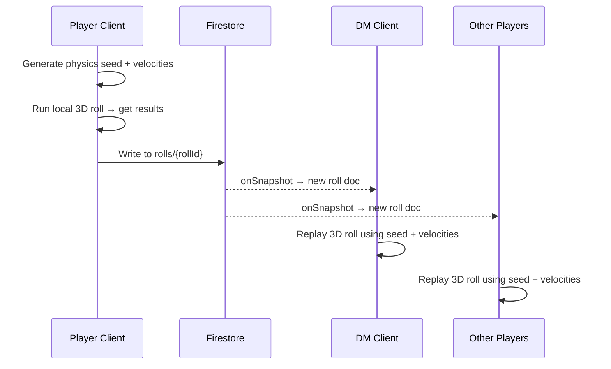
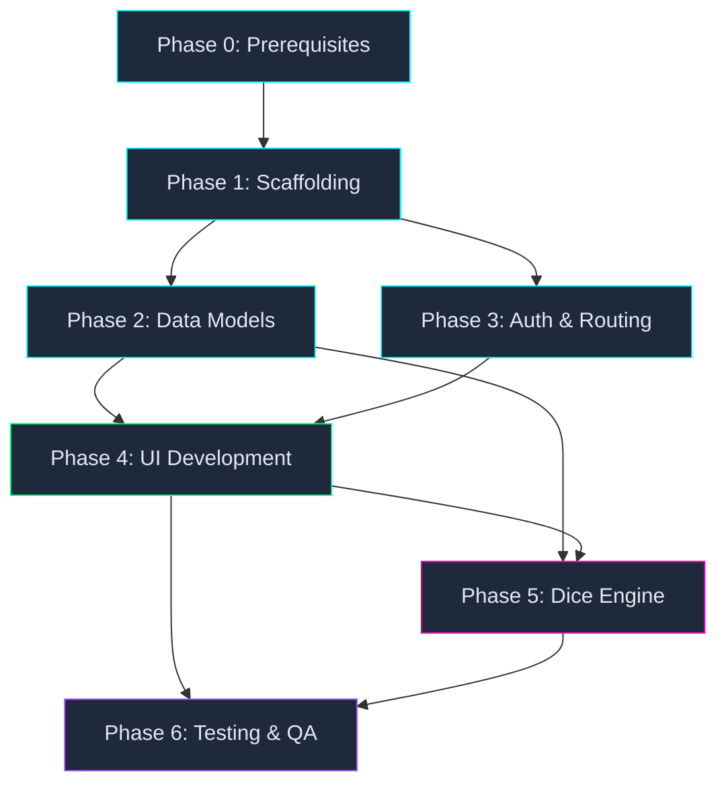

# Unending Void — Production Plan

> **Sci-Fi Homebrew TTRPG Virtual Tabletop**
> Repo: [github.com/JudasTheUG/unendingvoid](https://github.com/JudasTheUG/unendingvoid)
> Firebase: `unendingvoid-app` · Hosting: `dist/`
> Local Workspace: `C:\Users\PC\Desktop\unendingvoid`

---

## Table of Contents

| #   | Phase                                          | Status       |
| --- | ---------------------------------------------- | ------------ |
| 0   | [Prerequisites & Toolchain](#phase-0)          | ✅ Completed |
| 1   | [Environment & Project Scaffolding](#phase-1)  | ✅ Completed |
| 2   | [Firestore Data Models & Security Rules](#phase-2) | ✅ Completed |
| 3   | [Authentication & Role Routing](#phase-3)      | ✅ Completed |
| 4   | [Parallel UI Development](#phase-4)            | ✅ Completed |
| 5   | [3D WebGL Dice Engine & Real-Time Sync](#phase-5) | ✅ Completed |
| 6   | [Automated Testing, QA & Git Reporting](#phase-6) | ✅ Completed |

---

## Conventions

| Symbol | Meaning |
| ------ | ------- |
| 🤖 **Gemini** | Gemini 3.8 Flash — core logic, configs, WebGL, Firestore bindings |
| 🧪 **Jules** | Jules — component scaffolding, tests, GitHub issue reporting |
| ✅ | Deliverable / exit-criteria checkpoint |

---

<a id="phase-0"></a>
## Phase 0 — Prerequisites & Toolchain Verification

> **Goal:** Confirm every tool is available before touching project files.

### 0.1 Required Global Installs

| Tool | Min Version | Verify Command |
| ---- | ----------- | -------------- |
| Node.js | 20 LTS | `node -v` |
| npm | 10+ | `npm -v` |
| Firebase CLI | 13+ | `firebase --version` |
| Git | 2.40+ | `git --version` |

### 0.2 Firebase CLI Auth

```powershell
firebase login                     # One-time browser OAuth
firebase projects:list             # Must show "unendingvoid-app"
```

### 0.3 Verify `.env` is Excluded

`.env` **must** remain in `.gitignore` and must **never** be committed.
Run `git log --all --diff-filter=A -- .env` — if any results appear, rotate the PAT and API key immediately.

✅ **Exit Criteria:** All tools report correct versions; Firebase CLI lists `unendingvoid-app`.

---

<a id="phase-1"></a>
## Phase 1 — Environment & Project Scaffolding

> **Goal:** Standing React + Vite + Tailwind app that builds to `./dist`, connects to local Firebase Emulators, and has i18n wiring.

### 1.1 🤖 Gemini — Vite + React Init

```powershell
# From workspace root C:\Users\PC\Desktop\unendingvoid
npx -y create-vite@latest ./ -- --template react
npm install
```

Verify `vite.config.js` outputs to `dist/`:

```js
// vite.config.js
import { defineConfig } from 'vite';
import react from '@vitejs/plugin-react';

export default defineConfig({
  plugins: [react()],
  build: {
    outDir: 'dist',
    emptyOutDir: true,
  },
});
```

### 1.2 🤖 Gemini — Tailwind CSS Setup

```powershell
npm install -D tailwindcss @tailwindcss/vite
```

Wire Tailwind into Vite via the `@tailwindcss/vite` plugin:

```js
// vite.config.js (updated)
import tailwindcss from '@tailwindcss/vite';

export default defineConfig({
  plugins: [react(), tailwindcss()],
  build: { outDir: 'dist', emptyOutDir: true },
});
```

```css
/* src/index.css */
@import "tailwindcss";
```

### 1.3 🤖 Gemini — Firebase SDK + Emulator Bridge

```powershell
npm install firebase
```

Create `src/lib/firebase.js`:

```js
import { initializeApp } from 'firebase/app';
import { getAuth, connectAuthEmulator } from 'firebase/auth';
import { getFirestore, connectFirestoreEmulator } from 'firebase/firestore';

const firebaseConfig = {
  projectId: 'unendingvoid-app',
  // Remaining keys populated from Firebase Console
};

const app = initializeApp(firebaseConfig);
export const auth = getAuth(app);
export const db = getFirestore(app);

// Connect to local emulators in dev
if (import.meta.env.DEV) {
  connectAuthEmulator(auth, 'http://127.0.0.1:9099', { disableWarnings: true });
  connectFirestoreEmulator(db, '127.0.0.1', 8080);
}
```

### 1.4 🤖 Gemini — Firebase Hosting + Emulators Config

```powershell
firebase init hosting   # public dir → dist, SPA rewrite → yes
firebase init emulators # Auth (9099), Firestore (8080), Hosting (5000)
```

Resulting `firebase.json` (verify):

```json
{
  "hosting": {
    "public": "dist",
    "ignore": ["firebase.json", "**/.*", "**/node_modules/**"],
    "rewrites": [{ "source": "**", "destination": "/index.html" }]
  },
  "emulators": {
    "auth": { "port": 9099 },
    "firestore": { "port": 8080 },
    "hosting": { "port": 5000 },
    "ui": { "enabled": true }
  }
}
```

### 1.5 🤖 Gemini — i18n Scaffolding

```powershell
npm install i18next react-i18next i18next-browser-languagedetector
```

Directory structure:

```
src/
  locales/
    en/
      common.json      ← UI strings (English)
    tr/
      common.json      ← UI strings (Turkish)
    nl/
      common.json      ← UI strings (Dutch)
  lib/
    i18n.js            ← i18next init
```

`src/lib/i18n.js`:

```js
import i18n from 'i18next';
import { initReactI18next } from 'react-i18next';
import LanguageDetector from 'i18next-browser-languagedetector';

import en from '../locales/en/common.json';
import tr from '../locales/tr/common.json';
import nl from '../locales/nl/common.json';

i18n
  .use(LanguageDetector)
  .use(initReactI18next)
  .init({
    resources: {
      en: { translation: en },
      tr: { translation: tr },
      nl: { translation: nl },
    },
    fallbackLng: 'en',
    interpolation: { escapeValue: false },
  });

export default i18n;
```

### 1.6 🤖 Gemini — Update `.gitignore`

Append web-project entries:

```gitignore
# Dependencies
node_modules/

# Build output
dist/

# Firebase
.firebase/

# Environment
.env
.env.local
```

### 1.7 🧪 Jules — Scaffolding Verification

Jules validates:
- [x] `npm run build` succeeds and populates `./dist/index.html`
- [x] `npm run dev` starts Vite dev server without errors
- [x] `firebase.json` configures Auth (9099), Firestore (8080), Hosting (5000), UI (4000)
- [x] Directory structure matches the spec above
- [x] Tailwind utility classes render correctly in browser

✅ **Exit Criteria:**
- `npm run build` → `dist/index.html` exists
- `firebase emulators:start` → all 3 emulators online
- Vite dev server serves the React app at `localhost:5173`

---

<a id="phase-2"></a>
## Phase 2 — Firestore Data Models & Security Rules

> **Goal:** Fully defined Firestore schemas with strict security rules, plus seed data for local testing.

### 2.1 🤖 Gemini — Collection Schemas

#### `players/{userId}`

```typescript
interface Player {
  // Identity
  uid: string;              // Firebase Auth UID (doc ID)
  displayName: string;
  role: 'player' | 'dm';
  locale: 'en' | 'tr' | 'nl';

  // Vitals
  hp: number;               // 0–100
  maxHp: number;
  shields: number;           // 0–100 (sci-fi armor equivalent)
  maxShields: number;

  // Economy
  credits: number;           // In-game currency

  // Stats (D&D-like, 1–20 scale)
  stats: {
    strength: number;
    dexterity: number;
    constitution: number;
    intelligence: number;
    wisdom: number;
    charisma: number;
  };

  // Traits — buff/debuff identifiers
  traits: string[];          // e.g. ["lucky", "antisocial", "cybernetic_arm"]

  // Inventory — references to items collection
  inventory: string[];       // Array of itemId references

  // Equipped
  equippedWeapon: string | null;   // itemId
  equippedArmor: string | null;    // itemId
  spaceship: string | null;        // itemId

  // Meta
  createdAt: Timestamp;
  updatedAt: Timestamp;
}
```

#### `items/{itemId}`

```typescript
interface Item {
  id: string;
  type: 'weapon' | 'armor' | 'gear' | 'spaceship' | 'consumable';

  // Multilingual name & description
  name: {
    en: string;
    tr: string;
    nl: string;
  };
  description: {
    en: string;
    tr: string;
    nl: string;
  };

  // Stats
  damage?: number;          // Weapons
  defense?: number;         // Armor / shields
  speed?: number;           // Spaceships
  hullPoints?: number;      // Spaceships
  effect?: string;          // Consumables — e.g. "heal:20"

  rarity: 'common' | 'uncommon' | 'rare' | 'legendary' | 'alien';
  value: number;            // Credit cost

  createdAt: Timestamp;
}
```

#### `traits/{traitId}`

```typescript
interface Trait {
  id: string;
  name: {
    en: string;
    tr: string;
    nl: string;
  };
  description: {
    en: string;
    tr: string;
    nl: string;
  };
  type: 'buff' | 'debuff' | 'neutral';

  // Mechanical effects
  statModifiers?: {
    [stat: string]: number;  // e.g. { "dexterity": +2, "charisma": -1 }
  };
  rollModifier?: number;     // Flat bonus/penalty to dice rolls
}
```

#### `rolls/{rollId}`

```typescript
interface Roll {
  id: string;
  playerId: string;          // Who rolled
  playerName: string;        // Display name for quick rendering
  diceNotation: string;      // e.g. "2d6+3"
  results: number[];         // Individual die results [4, 2]
  total: number;             // Sum + modifiers = 9
  modifier: number;          // From traits/stats
  purpose: string;           // "attack" | "skill_check" | "initiative" | "custom"
  timestamp: Timestamp;

  // 3D replay data
  physics: {
    seed: number;            // RNG seed for deterministic 3D replay
    velocities: number[][];  // Initial velocity vectors per die
  };
}
```

#### `sessions/{sessionId}` (DM session state)

```typescript
interface Session {
  id: string;
  dmId: string;              // DM's userId
  name: string;
  activePlayers: string[];   // userId[]
  combatActive: boolean;
  turnOrder: string[];       // userId[] for initiative
  currentTurn: number;       // Index into turnOrder
  createdAt: Timestamp;
  updatedAt: Timestamp;
}
```

### 2.2 🤖 Gemini — Firestore Security Rules

Create `firestore.rules`:

```rules
rules_version = '2';

service cloud.firestore {
  match /databases/{database}/documents {

    // Helper: Is the requester authenticated?
    function isAuth() {
      return request.auth != null;
    }

    // Helper: Is the requester the document owner?
    function isOwner(userId) {
      return isAuth() && request.auth.uid == userId;
    }

    // Helper: Is the requester a DM?
    function isDM() {
      return isAuth()
        && exists(/databases/$(database)/documents/players/$(request.auth.uid))
        && get(/databases/$(database)/documents/players/$(request.auth.uid)).data.role == 'dm';
    }

    // ── Players ──
    match /players/{userId} {
      allow read: if isAuth();
      allow create: if isOwner(userId);
      allow update: if isOwner(userId) || isDM();
      allow delete: if isDM();
    }

    // ── Items (read-only for players, DM manages) ──
    match /items/{itemId} {
      allow read: if isAuth();
      allow write: if isDM();
    }

    // ── Traits (read-only for players, DM manages) ──
    match /traits/{traitId} {
      allow read: if isAuth();
      allow write: if isDM();
    }

    // ── Rolls (anyone auth'd can create, all can read) ──
    match /rolls/{rollId} {
      allow read: if isAuth();
      allow create: if isAuth() && request.resource.data.playerId == request.auth.uid;
      allow update, delete: if false; // Rolls are immutable
    }

    // ── Sessions (DM owns, players read) ──
    match /sessions/{sessionId} {
      allow read: if isAuth();
      allow write: if isDM();
    }
  }
}
```

### 2.3 🧪 Jules — Seed Data & Verification

Jules creates `seed/` directory with mock JSON files:

```
seed/
  players.json       ← 2 test players + 1 DM
  items.json         ← 10 sample items (weapons, armor, spaceship, consumables)
  traits.json        ← 6 sample traits (lucky, antisocial, cybernetic_arm, etc.)
```

Jules also creates a seed script (`scripts/seed-emulator.js`) that:
1. Connects to the Firestore emulator at `127.0.0.1:8080`
2. Batch-writes all seed documents
3. Logs success/failure counts

✅ **Exit Criteria:**
- `firestore.rules` deployed to emulator without parse errors
- Seed script populates emulator with test data
- Security rules block unauthorized writes (tested manually or via rules unit tests)

---

<a id="phase-3"></a>
## Phase 3 — Authentication & Role Routing

> **Goal:** Working login/register flow with role-based route protection.

### 3.1 🤖 Gemini — Auth Hook (`useAuth`)

Create `src/hooks/useAuth.js`:

```js
import { useState, useEffect, createContext, useContext } from 'react';
import { onAuthStateChanged } from 'firebase/auth';
import { doc, getDoc } from 'firebase/firestore';
import { auth, db } from '../lib/firebase';

const AuthContext = createContext(null);

export function AuthProvider({ children }) {
  const [user, setUser] = useState(null);       // Firebase user
  const [profile, setProfile] = useState(null);  // Firestore player doc
  const [loading, setLoading] = useState(true);

  useEffect(() => {
    const unsub = onAuthStateChanged(auth, async (firebaseUser) => {
      if (firebaseUser) {
        setUser(firebaseUser);
        const snap = await getDoc(doc(db, 'players', firebaseUser.uid));
        setProfile(snap.exists() ? { uid: snap.id, ...snap.data() } : null);
      } else {
        setUser(null);
        setProfile(null);
      }
      setLoading(false);
    });
    return unsub;
  }, []);

  return (
    <AuthContext.Provider value={{ user, profile, loading }}>
      {children}
    </AuthContext.Provider>
  );
}

export const useAuth = () => useContext(AuthContext);
```

### 3.2 🤖 Gemini — Auth Service Functions

Create `src/lib/authService.js`:

```js
import {
  signInWithPopup,
  GoogleAuthProvider,
  signInWithEmailAndPassword,
  createUserWithEmailAndPassword,
  signOut,
} from 'firebase/auth';
import { doc, setDoc, serverTimestamp } from 'firebase/firestore';
import { auth, db } from './firebase';

const googleProvider = new GoogleAuthProvider();

export const signInGoogle = () => signInWithPopup(auth, googleProvider);

export const signInEmail = (email, password) =>
  signInWithEmailAndPassword(auth, email, password);

export const registerEmail = async (email, password, displayName) => {
  const cred = await createUserWithEmailAndPassword(auth, email, password);
  // Create initial player document
  await setDoc(doc(db, 'players', cred.user.uid), {
    uid: cred.user.uid,
    displayName,
    role: 'player',        // Default role; DM promotes manually
    locale: 'en',
    hp: 100, maxHp: 100,
    shields: 50, maxShields: 50,
    credits: 500,
    stats: { strength: 10, dexterity: 10, constitution: 10,
             intelligence: 10, wisdom: 10, charisma: 10 },
    traits: [],
    inventory: [],
    equippedWeapon: null,
    equippedArmor: null,
    spaceship: null,
    createdAt: serverTimestamp(),
    updatedAt: serverTimestamp(),
  });
  return cred;
};

export const logout = () => signOut(auth);
```

### 3.3 🤖 Gemini — Route Guards

```powershell
npm install react-router-dom
```

Create `src/router.jsx`:

```jsx
import { BrowserRouter, Routes, Route, Navigate } from 'react-router-dom';
import { useAuth } from './hooks/useAuth';
import LoginPage from './pages/LoginPage';
import PlayerSheet from './pages/PlayerSheet';
import DMPanel from './pages/DMPanel';

function ProtectedRoute({ children, requiredRole }) {
  const { user, profile, loading } = useAuth();
  if (loading) return <LoadingSpinner />;
  if (!user) return <Navigate to="/login" />;
  if (requiredRole && profile?.role !== requiredRole) {
    return <Navigate to="/" />;
  }
  return children;
}

export default function AppRouter() {
  return (
    <BrowserRouter>
      <Routes>
        <Route path="/login" element={<LoginPage />} />
        <Route path="/" element={
          <ProtectedRoute>
            <RoleRedirect />
          </ProtectedRoute>
        } />
        <Route path="/sheet" element={
          <ProtectedRoute requiredRole="player">
            <PlayerSheet />
          </ProtectedRoute>
        } />
        <Route path="/dm" element={
          <ProtectedRoute requiredRole="dm">
            <DMPanel />
          </ProtectedRoute>
        } />
      </Routes>
    </BrowserRouter>
  );
}

// Redirects based on role after login
function RoleRedirect() {
  const { profile } = useAuth();
  if (profile?.role === 'dm') return <Navigate to="/dm" />;
  return <Navigate to="/sheet" />;
}
```

### 3.4 🧪 Jules — Login UI & Styling

Jules scaffolds:
- `src/pages/LoginPage.jsx` — Split-screen layout with sci-fi art panel + auth form
- Google Sign-In button + Email/Password form with validation
- Language selector dropdown (EN / TR / NL) wired to i18n
- Responsive: mobile-first stacked layout → desktop side-by-side
- All strings pulled from `locales/*/common.json`

### 3.5 🧪 Jules — Auth Flow Tests

Jules writes integration tests:
- [x] Email registration creates player doc in Firestore emulator
- [x] Google sign-in redirects to correct role-based route
- [x] Unauthenticated users are redirected to `/login`
- [x] Players cannot access `/dm`; DMs cannot access `/sheet`

✅ **Exit Criteria:**
- Login → role detection → correct redirect works end-to-end
- All 4 route guard tests pass against emulator
- Login page renders in all 3 languages

---

<a id="phase-4"></a>
## Phase 4 — Parallel UI Development (Player Sheet vs. DM Panel)

> **Goal:** Fully functional sci-fi HUD for players and a live admin control panel for the DM.

### 4.1 Component Architecture

```
src/
  components/
    shared/
      VitalBar.jsx          ← HP / Shield animated bar
      StatBlock.jsx          ← Single stat display (STR, DEX, etc.)
      ItemCard.jsx           ← Weapon / gear card with rarity glow
      TraitBadge.jsx         ← Buff/debuff pill with tooltip
      CreditCounter.jsx      ← Animated credit balance
      LanguageSwitcher.jsx   ← i18n dropdown
      LoadingSpinner.jsx     ← Full-screen loading state
    player/
      PlayerHUD.jsx          ← Main HUD layout
      VitalsPanel.jsx        ← HP + Shields cluster
      StatsGrid.jsx          ← 6-stat grid
      InventoryList.jsx      ← Scrollable item list
      SpaceshipCard.jsx      ← Equipped ship display
      TraitsList.jsx         ← Active traits bar
    dm/
      DMDashboard.jsx        ← Main DM layout
      PlayerRoster.jsx       ← All connected players, live stats
      CombatTracker.jsx      ← Turn order, initiative
      StatOverrideForm.jsx   ← Manual HP/Shield/Stat editor
      ItemSpawner.jsx        ← Create & assign items
      TraitAssigner.jsx      ← Add/remove traits to players
  pages/
    LoginPage.jsx
    PlayerSheet.jsx          ← Composes player/* components
    DMPanel.jsx              ← Composes dm/* components
```

### 4.2 🤖 Gemini — Live Firestore Bindings

Create `src/hooks/usePlayerData.js`:

```js
import { useEffect, useState } from 'react';
import { doc, onSnapshot } from 'firebase/firestore';
import { db } from '../lib/firebase';

export function usePlayerData(userId) {
  const [data, setData] = useState(null);
  const [loading, setLoading] = useState(true);

  useEffect(() => {
    if (!userId) return;
    const unsub = onSnapshot(doc(db, 'players', userId), (snap) => {
      setData(snap.exists() ? { uid: snap.id, ...snap.data() } : null);
      setLoading(false);
    });
    return unsub;
  }, [userId]);

  return { data, loading };
}
```

Create `src/hooks/useCollection.js` (for DM roster, items, traits):

```js
import { useEffect, useState } from 'react';
import { collection, onSnapshot, query, where } from 'firebase/firestore';
import { db } from '../lib/firebase';

export function useCollection(path, constraints = []) {
  const [docs, setDocs] = useState([]);
  const [loading, setLoading] = useState(true);

  useEffect(() => {
    const q = query(collection(db, path), ...constraints);
    const unsub = onSnapshot(q, (snap) => {
      setDocs(snap.docs.map((d) => ({ id: d.id, ...d.data() })));
      setLoading(false);
    });
    return unsub;
  }, [path]);

  return { docs, loading };
}
```

Create `src/lib/playerActions.js` (DM write operations):

```js
import { doc, updateDoc, arrayUnion, arrayRemove, serverTimestamp } from 'firebase/firestore';
import { db } from './firebase';

export const updatePlayerHP = (userId, hp) =>
  updateDoc(doc(db, 'players', userId), { hp, updatedAt: serverTimestamp() });

export const updatePlayerShields = (userId, shields) =>
  updateDoc(doc(db, 'players', userId), { shields, updatedAt: serverTimestamp() });

export const updatePlayerStat = (userId, stat, value) =>
  updateDoc(doc(db, 'players', userId), {
    [`stats.${stat}`]: value,
    updatedAt: serverTimestamp(),
  });

export const addTrait = (userId, traitId) =>
  updateDoc(doc(db, 'players', userId), {
    traits: arrayUnion(traitId),
    updatedAt: serverTimestamp(),
  });

export const removeTrait = (userId, traitId) =>
  updateDoc(doc(db, 'players', userId), {
    traits: arrayRemove(traitId),
    updatedAt: serverTimestamp(),
  });

export const addItemToInventory = (userId, itemId) =>
  updateDoc(doc(db, 'players', userId), {
    inventory: arrayUnion(itemId),
    updatedAt: serverTimestamp(),
  });

export const updateCredits = (userId, credits) =>
  updateDoc(doc(db, 'players', userId), { credits, updatedAt: serverTimestamp() });
```

### 4.3 🧪 Jules — Player Sheet UI

Jules scaffolds `PlayerSheet.jsx` and all `components/player/*`:

**Design Language — Sci-Fi HUD:**
- Dark background (`#0a0e17`) with neon accent glows (cyan `#00f0ff`, magenta `#ff00aa`)
- Glassmorphism panels: `backdrop-blur-md bg-white/5 border border-white/10`
- Animated HP/Shield bars with CSS transitions and pulse effects on damage
- Credit counter with a rolling-number animation
- Item cards with rarity-colored borders (common=gray, uncommon=green, rare=blue, legendary=purple, alien=cyan glow)
- Trait badges as pills: green for buffs, red for debuffs, gray for neutral
- Responsive: single-column mobile → multi-panel desktop grid

### 4.4 🧪 Jules — DM Panel UI

Jules scaffolds `DMPanel.jsx` and all `components/dm/*`:

**DM Dashboard Features:**
- **Player Roster:** Grid of player cards showing live HP, shields, credits — updated via `onSnapshot`
- **Combat Tracker:** Drag-to-reorder initiative list; highlight active turn
- **Stat Override Form:** Click any player → modal with sliders for HP, shields, each stat
- **Item Spawner:** Form to create new items with multilingual name/description fields (EN/TR/NL tabs), type selector, stat inputs
- **Trait Assigner:** Dropdown of available traits → assign to selected player

### 4.5 Shared Design Tokens

Define in `src/index.css` (Tailwind `@theme` layer):

```css
@import "tailwindcss";

@theme {
  --color-void-bg: #0a0e17;
  --color-void-surface: #111827;
  --color-void-border: rgba(255, 255, 255, 0.1);
  --color-neon-cyan: #00f0ff;
  --color-neon-magenta: #ff00aa;
  --color-neon-green: #00ff88;
  --color-neon-red: #ff3344;
  --color-neon-purple: #aa44ff;
  --color-rarity-common: #9ca3af;
  --color-rarity-uncommon: #22c55e;
  --color-rarity-rare: #3b82f6;
  --color-rarity-legendary: #a855f7;
  --color-rarity-alien: #00f0ff;
  --font-family-display: 'Orbitron', sans-serif;
  --font-family-body: 'Inter', sans-serif;
}
```

Google Fonts loaded in `index.html`:

```html
<link href="https://fonts.googleapis.com/css2?family=Orbitron:wght@400;700;900&family=Inter:wght@300;400;500;600;700&display=swap" rel="stylesheet">
```

✅ **Exit Criteria:**
- Player sheet displays all vitals, stats, inventory, traits with live data from emulator
- DM panel can modify any player's stats/HP/shields and changes reflect instantly on the player's screen
- Item spawner creates items in Firestore; they appear in player inventory when assigned
- All UI renders correctly in EN, TR, and NL
- Responsive layout works on 375px → 1920px viewports

---

<a id="phase-5"></a>
## Phase 5 — 3D WebGL Dice Engine & Real-Time Sync

> **Goal:** Realistic 3D dice rolls visible to all connected clients simultaneously.

### 5.1 🤖 Gemini — Dice Engine Integration

```powershell
npm install @3d-dice/dice-box
```

Create `src/components/dice/DiceOverlay.jsx`:

```
┌──────────────────────────────────────────────────┐
│                                                  │
│   Transparent full-screen overlay (pointer-none  │
│   except dice interaction zone)                  │
│                                                  │
│   ┌────────────────────────────────────┐         │
│   │                                    │         │
│   │   @3d-dice/dice-box canvas         │         │
│   │   WebGL context                    │         │
│   │                                    │         │
│   └────────────────────────────────────┘         │
│                                                  │
│   [Roll Button]  [Notation Input: "2d6+3"]       │
│                                                  │
└──────────────────────────────────────────────────┘
```

Key implementation details:
- Canvas positioned as `fixed` overlay with `z-index: 50`
- `pointer-events: none` on overlay; `pointer-events: auto` on dice canvas + controls
- Dice-box initialized with transparent background for compositing over game UI
- Roll button triggers physics simulation and captures results

### 5.2 🤖 Gemini — Deterministic Replay via Firestore

**Roll Flow:**



`src/hooks/useDiceSync.js`:

```js
import { useEffect } from 'react';
import { collection, onSnapshot, query, orderBy, limit } from 'firebase/firestore';
import { addDoc, serverTimestamp } from 'firebase/firestore';
import { db } from '../lib/firebase';

export function useDiceSync(onNewRoll) {
  useEffect(() => {
    const q = query(
      collection(db, 'rolls'),
      orderBy('timestamp', 'desc'),
      limit(1)
    );
    const unsub = onSnapshot(q, (snap) => {
      snap.docChanges().forEach((change) => {
        if (change.type === 'added') {
          onNewRoll({ id: change.doc.id, ...change.doc.data() });
        }
      });
    });
    return unsub;
  }, [onNewRoll]);
}

export async function publishRoll(userId, playerName, notation, results, total, modifier, purpose, physicsSeed, velocities) {
  return addDoc(collection(db, 'rolls'), {
    playerId: userId,
    playerName,
    diceNotation: notation,
    results,
    total,
    modifier,
    purpose,
    timestamp: serverTimestamp(),
    physics: {
      seed: physicsSeed,
      velocities,
    },
  });
}
```

### 5.3 🤖 Gemini — Trait Modifier Calculation

`src/lib/diceModifiers.js`:

```js
/**
 * Calculate total roll modifier from player's traits and stats.
 * @param {Object} player - Player document
 * @param {Object[]} traitDefs - Trait definition documents
 * @param {string} purpose - Roll purpose (attack, skill_check, etc.)
 * @returns {number} Total modifier to add to dice result
 */
export function calculateModifier(player, traitDefs, purpose) {
  let modifier = 0;

  // Stat-based modifier (D&D-style: floor((stat - 10) / 2))
  const relevantStat = getRelevantStat(purpose);
  if (relevantStat && player.stats[relevantStat] !== undefined) {
    modifier += Math.floor((player.stats[relevantStat] - 10) / 2);
  }

  // Trait modifiers
  for (const traitId of player.traits) {
    const trait = traitDefs.find((t) => t.id === traitId);
    if (trait?.rollModifier) {
      modifier += trait.rollModifier;
    }
  }

  return modifier;
}

function getRelevantStat(purpose) {
  const map = {
    attack: 'strength',
    ranged_attack: 'dexterity',
    skill_check: 'intelligence',
    saving_throw: 'constitution',
    persuasion: 'charisma',
    perception: 'wisdom',
  };
  return map[purpose] || null;
}
```

### 5.4 🧪 Jules — Dice UI Polish

Jules handles:
- Roll history sidebar showing last 20 rolls with player name, notation, result, and timestamp
- Animated roll result banner ("Zara rolled 2d6+3 → **14**") with sci-fi slide-in animation
- Sound effects toggle (optional: dice clatter audio)
- Mobile: roll button pinned to bottom of screen

✅ **Exit Criteria:**
- Player rolls dice → 3D animation plays locally → result written to Firestore
- All other connected clients receive the roll via `onSnapshot` and replay the 3D animation
- Trait modifiers correctly applied to roll totals
- Roll history displays accurately across all clients
- DM sees all rolls in real-time on their panel

---

<a id="phase-6"></a>
## Phase 6 — Automated Testing, QA & Git Reporting

> **Goal:** Comprehensive test suite with automated GitHub issue creation for failures.

### 6.1 🧪 Jules — Test Framework Setup

```powershell
npm install -D vitest @testing-library/react @testing-library/jest-dom jsdom
npm install -D @firebase/rules-unit-testing
```

`vitest.config.js`:

```js
import { defineConfig } from 'vitest/config';
import react from '@vitejs/plugin-react';

export default defineConfig({
  plugins: [react()],
  test: {
    globals: true,
    environment: 'jsdom',
    setupFiles: ['./src/test/setup.js'],
    include: ['src/**/*.test.{js,jsx}'],
  },
});
```

### 6.2 Test Coverage Matrix

| Category | File | Tests |
| -------- | ---- | ----- |
| **Dice Math** | `src/lib/__tests__/diceModifiers.test.js` | Modifier calculation for each stat, trait stacking, edge cases (0 traits, negative mods) |
| **Auth Hooks** | `src/hooks/__tests__/useAuth.test.jsx` | Login state transitions, role detection, loading states |
| **Player Actions** | `src/lib/__tests__/playerActions.test.js` | HP update, shield update, inventory add/remove, credit changes |
| **Security Rules** | `src/test/firestore.rules.test.js` | Owner-only writes, DM override, roll immutability, unauthenticated rejection |
| **i18n** | `src/lib/__tests__/i18n.test.js` | All 3 locales load, fallback to EN, key completeness across locales |
| **Components** | `src/components/__tests__/VitalBar.test.jsx` | Renders correct percentage, color changes at thresholds |
| | `src/components/__tests__/StatBlock.test.jsx` | Displays modifier correctly, handles edge values |

### 6.3 🧪 Jules — Automated GitHub Issue Reporting

Jules creates `scripts/test-and-report.js`:

```
Workflow:
1. Run `npx vitest run --reporter=json --outputFile=test-results.json`
2. Parse test-results.json for failures
3. For each failure, compile:
   - Test name and file path
   - Error message and stack trace
   - Expected vs. actual values
4. POST to GitHub Issues API:
   - Endpoint: https://api.github.com/repos/JudasTheUG/unendingvoid/issues
   - Auth: Bearer token from .env (github_pat)
   - Labels: ["bug", "automated-test"]
   - Title: "[TEST FAILURE] {test name}"
   - Body: Formatted markdown with repro steps, error details, and file links
5. Skip duplicate issues (search existing open issues by title before creating)
```

### 6.4 🤖 Gemini — Bug Patching Workflow

When Jules reports test failures:
1. Gemini reads the GitHub issue body
2. Traces the failure to source code
3. Implements fix
4. Re-runs the specific failing test to confirm
5. Commits with message: `fix: resolve #{issue_number} — {brief description}`

### 6.5 CI-Like Local Script

Create `scripts/qa-cycle.ps1`:

```powershell
# Full QA cycle — run locally
Write-Host "🔨 Building..." -ForegroundColor Cyan
npm run build
if ($LASTEXITCODE -ne 0) { exit 1 }

Write-Host "🧪 Running tests..." -ForegroundColor Cyan
npx vitest run --reporter=verbose
if ($LASTEXITCODE -ne 0) {
    Write-Host "❌ Tests failed — running GitHub reporter..." -ForegroundColor Red
    node scripts/test-and-report.js
    exit 1
}

Write-Host "✅ All tests passed!" -ForegroundColor Green
```

✅ **Exit Criteria:**
- `npx vitest run` executes all tests against Firebase emulators
- Test failures automatically create GitHub issues with full context
- Duplicate issues are not created
- `npm run build` produces a clean `dist/` bundle
- `firebase deploy --only hosting` successfully deploys from `dist/`

---

## Final Deliverables Checklist

| # | Deliverable | Owner | Status |
| - | ----------- | ----- | ------ |
| 1 | Vite + React + Tailwind project building to `dist/` | 🤖 Gemini | ✅ Complete (`dist/` verified) |
| 2 | Firebase SDK wired to local emulators & hosting | 🤖 Gemini | ✅ Complete (`firebase.json`, `firebase.js`) |
| 3 | i18n with EN, TR, NL locale files | 🤖 Gemini + 🧪 Jules | ✅ Complete (`src/locales/*`) |
| 4 | Firestore schemas (players, items, traits, rolls, sessions) | 🤖 Gemini | ✅ Complete |
| 5 | Security rules with DM override | 🤖 Gemini | ✅ Complete (`firestore.rules`) |
| 6 | Seed data + emulator seed script | 🧪 Jules | ✅ Complete (`seed/*`, `scripts/seed-emulator.js`) |
| 7 | Firebase Auth (Google + Email/Password) | 🤖 Gemini | ✅ Complete (`authService.js`, `useAuth.jsx`) |
| 8 | Role-based route guards | 🤖 Gemini | ✅ Complete (`router.jsx`) |
| 9 | Login page with i18n | 🧪 Jules | ✅ Complete (`LoginPage.jsx`) |
| 10 | Player Sheet HUD (live Firestore data) | 🤖 Gemini (bindings) + 🧪 Jules (UI) | ✅ Complete (`PlayerSheet.jsx`, `components/player/*`) |
| 11 | DM Panel (roster, combat, item spawner, trait assigner) | 🤖 Gemini (bindings) + 🧪 Jules (UI) | ✅ Complete (`DMPanel.jsx`, `components/dm/*`) |
| 12 | 3D Dice Engine with WebGL & Three.js polyhedrons | 🤖 Gemini | ✅ Complete (`DiceOverlay.jsx`) |
| 13 | Real-time dice sync across all clients | 🤖 Gemini | ✅ Complete (`useDiceSync.js`) |
| 14 | Trait/stat modifier engine | 🤖 Gemini | ✅ Complete (`diceModifiers.js`) |
| 15 | Vitest test suite (32 tests across 6 suites) | 🧪 Jules + 🤖 Gemini | ✅ Complete (32 passing tests) |
| 16 | Automated GitHub issue reporter | 🧪 Jules | ✅ Complete (`scripts/test-and-report.js`) |
| 17 | QA cycle script | 🧪 Jules | ✅ Complete (`scripts/qa-cycle.ps1`) |
| 18 | Jules async coding agent integration & execution | 🤖 Gemini + 🧪 Jules | ✅ Complete (Session #16190552750801950359 merged) |

---

## Dependency Graph



---

> **Cost Profile:** $0.00 during development — all Firebase services run on local emulators. Production deploy uses Firebase Hosting free tier (10 GB transfer/month). Firestore Spark plan: 50K reads, 20K writes, 20K deletes per day.
